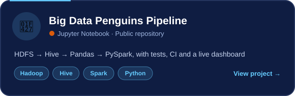
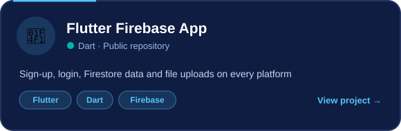
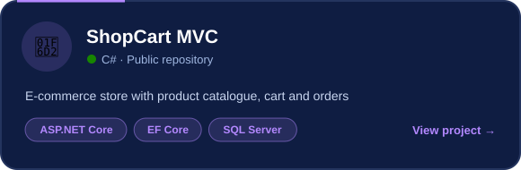
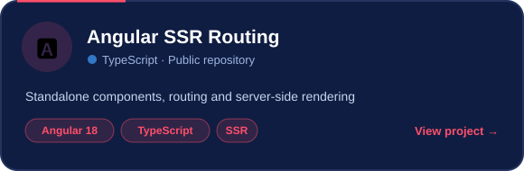
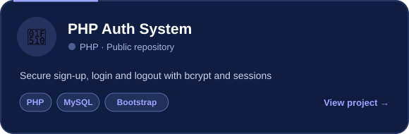
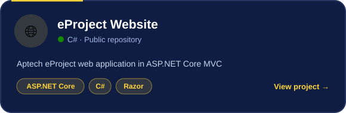

  <a href="#-introduction"><b>👨‍🏫 About</b></a> &nbsp;•&nbsp;
  <a href="#-aptech-programs-i-teach"><b>📚 Programs</b></a> &nbsp;•&nbsp;
  <a href="#-teaching-analytics"><b>📊 Analytics</b></a> &nbsp;•&nbsp;
  <a href="#-popular-repositories"><b>🔥 Repositories</b></a> &nbsp;•&nbsp;
  <a href="#️-technologies-i-teach"><b>🛠️ Tech Stack</b></a> &nbsp;•&nbsp;
  <a href="#-for-my-students"><b>🎯 Students</b></a>

---

## 👨‍🏫 Introduction

Assalam-o-Alaikum! I'm **Zeeshan Abbas**, **Senior Faculty and Manager Academics** at **Aptech Learning, North Nazimabad, Karachi**, and I am currently pursuing a **Masters in Data Science**.

I have taught **every semester and every technology** of Aptech's career programs, from a student's very first web page to full-stack, mobile, cloud and AI applications. Today I lead a team of faculty members, design how our batches learn, and personally mentor students through their eProjects until they are ready for real jobs and freelancing.

> 🎯 **My promise to every student and parent:** practical skills, real projects, and a portfolio that gets you hired.

<table>
<tr>
<td align="center" width="25%"><h3>🎓</h3><b>Masters</b> Data Science</td>
<td align="center" width="25%"><h3>🏫</h3><b>Senior Faculty</b> & Manager Academics</td>
<td align="center" width="25%"><h3>👥</h3><b>Faculty Team Lead</b> Aptech North Nazimabad</td>
<td align="center" width="25%"><h3>💻</h3><b>All Semesters</b> CPISM to ADSE, AI & DS</td>
</tr>
</table>

### 💬 *"Code seekho, project banao, career banao: Sir Zeeshan ke saath."*

---

## 📚 Aptech Programs I Teach

| Program | Semester | What students master |
|---|---|---|
| **ACCP AI / ADSE** | **CPISM** | Office automation, HTML5, CSS3, JavaScript, Bootstrap, jQuery, Git, SEO, UI/UX, responsive website eProject |
| | **DISM** | Programming logic, C/C++, OOP, SQL Server, PHP & MySQL, dynamic web apps |
| | **HDSE I & II** | C#, ASP.NET Core MVC, Entity Framework, Java, Laravel, REST APIs |
| | **ADSE I & II** | React, Angular, Node.js, MongoDB, Flutter & Dart, Android, Azure & AWS cloud, Python, AI integration |
| **HDSE (with Intermediate equivalency)** | Semesters I to IV | Full-stack web, .NET and open-source development, mobile apps |
| **Diploma in Data Science** | 2 semesters | T-SQL, MongoDB, statistics, Python, Pandas, data visualisation, Power BI, Big Data |
| **Diploma in Artificial Intelligence** | 2 semesters | Python, machine learning, deep learning, NLP, AI applications |
| **Short courses** | Flexible | Web development, Python programming, Laravel, Flutter, MERN stack, Git & GitHub |

---

## ⚡ Teaching Expertise

## 📊 Teaching Analytics

---

## 🔥 Popular Repositories

---|---|---|
| [**🐧 Big Data Penguins Pipeline**](https://github.com/zeeshan123abbas/penguins-hadoop-assessment) | End-to-end pipeline HDFS → Hive → Pandas → PySpark, with tests, CI and a [live dashboard](https://zeeshan123abbas.github.io/penguins-hadoop-assessment/) | Hadoop · Hive · Spark · Python |
| [**📱 Flutter Firebase App**](https://github.com/zeeshan123abbas/Flutter_project) | Mobile app with sign-up, login, Firestore data and file uploads | Flutter · Dart · Firebase |
| [**🛒 ShopCart MVC**](https://github.com/zeeshan123abbas/AddtoCartproject.cs) | E-commerce store with products, cart and orders | ASP.NET Core MVC · EF Core |
| [**🅰️ Angular SSR Routing**](https://github.com/zeeshan123abbas/Angular-Project) | Standalone-component app with server-side rendering | Angular 18 · TypeScript |
| [**🔐 PHP Auth System**](https://github.com/zeeshan123abbas/PHP-Code) | Secure sign-up, login and logout with bcrypt and sessions | PHP · MySQL · Bootstrap |
| [**🌐 eProject Website**](https://github.com/zeeshan123abbas/eProject) | Aptech eProject web application | ASP.NET Core MVC |

---

## 🛠️ Technologies I Teach

<b>🔎 View as classic badges</b>

**Programming Languages**  

**Frontend & UI/UX**  

**Backend & Frameworks**  

**Mobile & Cloud**  

**Databases**  

**Data Science, AI & Big Data**  

**Tools**  

---

## 📈 Contributions

  

<picture>
  <source media="(prefers-color-scheme: dark)" srcset="https://raw.githubusercontent.com/zeeshan123abbas/zeeshan123abbas/output/github-snake-dark.svg" />
  
</picture>

---

## 🎯 For My Students

> 💬 *"Code every day, push every day. Your GitHub is your CV."*

- ⭐ **Star and fork** these repositories to practise
- 🛠️ **Rebuild** each project, then add one feature of your own
- 📂 Keep **every eProject** on GitHub with a proper README
- 📬 Questions? Open an **issue** on the project or email me

## 👪 For Parents

Your child learns from a faculty team that teaches **current industry technologies**, builds a **real project every semester**, and graduates with a **public portfolio** that employers and universities can see.

---

📍 **Aptech Learning, North Nazimabad, Karachi, Pakistan**

